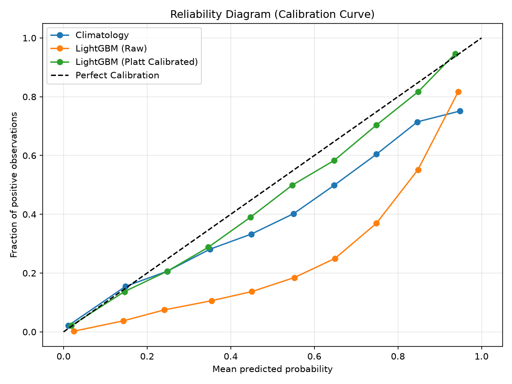
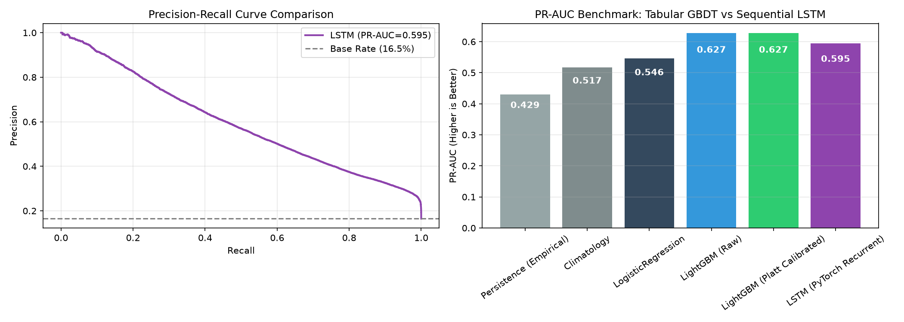
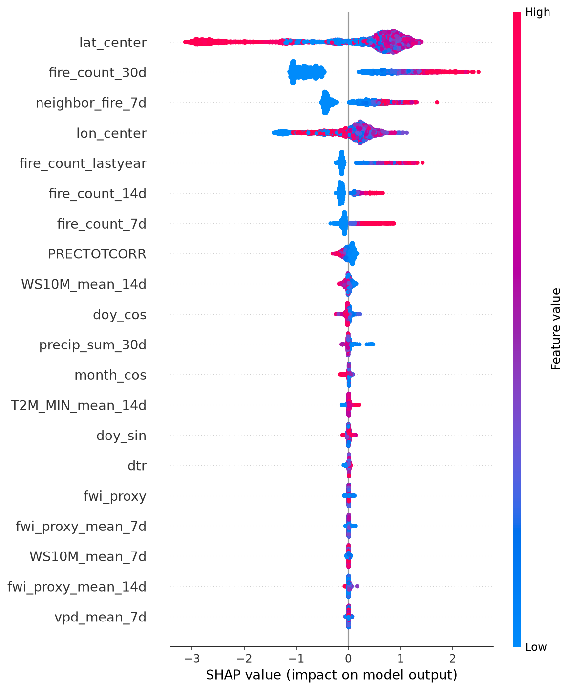
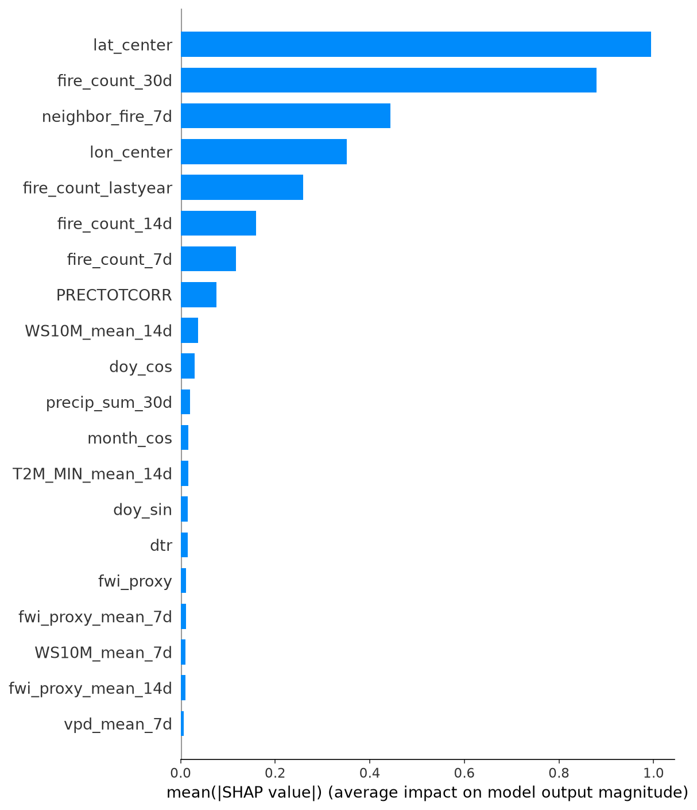
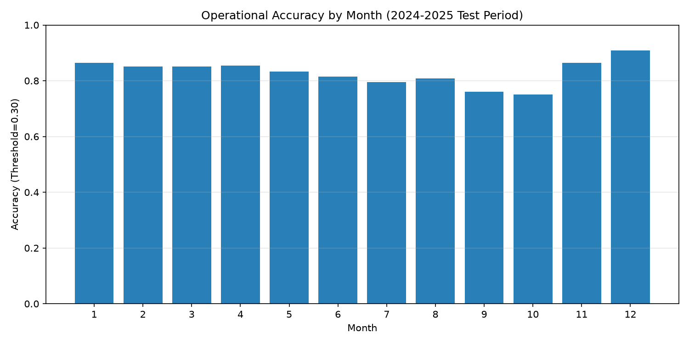
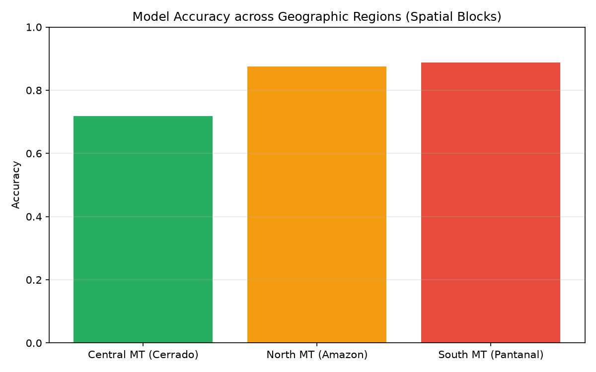

# 🇧🇷 Brazil Wildfire Risk Forecast (Mato Grosso)

[](https://www.python.org/)
[](LICENSE)
[]()
[]()
[](https://fastapi.tiangolo.com)
[](https://streamlit.io)

> **End-to-end machine learning pipeline predicting wildfire hotspot probability for the next 7 days in geographic grid cells, integrating INPE reference satellite observations and NASA POWER daily climate reanalysis, with an interactive web dashboard and real-time REST API.**

---

[🇧🇷 Versão em Português](README.pt-BR.md)

---

## 📌 Table of Contents
- [What the Project Is](#-what-the-project-is)
- [Motivation & Environmental Impact](#-motivation--environmental-impact)
- [Objectives](#-objectives)
- [Problem Definition](#-problem-definition)
- [Data Sources](#-data-sources)
- [Feature Engineering & Anti-Leakage Design](#-feature-engineering--anti-leakage-design)
- [Real Results & Model Comparison](#-real-results--model-comparison)
- [Explainability with SHAP](#-explainability-with-shap)
- [Error Analysis](#-error-analysis)
- [Demo: API & Streamlit Dashboard](#-demo-api--streamlit-dashboard)
- [Tech Stack & Architecture Decisions](#-tech-stack--architecture-decisions)
- [Repository Structure](#-repository-structure)
- [Installation & How to Run](#-installation--how-to-run)
- [Free Cloud Deployment](#-free-cloud-deployment)
- [Known Limitations & Biases](#-known-limitations--biases)
- [Responsible AI & Disclaimer](#-responsible-ai--disclaimer)
- [Next Steps & Key Learnings](#-next-steps--key-learnings)
- [Author & Contact](#-author--contact)

---

## 🌲 What the Project Is

**brazil-wildfire-risk-forecast** is a production-grade machine learning system designed to anticipate wildfire occurrence across Brazil. The pipeline divides a geographical region into regular configurable grid cells (currently 0.5° ≈ 56 km), processes 10 years of satellite hotspot records alongside daily meteorological reanalysis data, and produces calibrated 7-day probabilistic fire hazard forecasts.

The project does not attempt to predict exact ignition coordinates deterministically; rather, it provides a **calibrated situational risk index** to support strategic resource deployment by wildfire brigades, environmental agencies, and regional authorities.

---

## 🌍 Motivation & Environmental Impact

Brazil suffers increasingly devastating fire seasons due to prolonged drought cycles amplified by climatic oscillations (such as strong El Niño events and Atlantic sea surface temperature anomalies) coupled with land-use pressures along agricultural frontiers. In 2024, the state of Mato Grosso experienced catastrophic wildfire records across the Cerrado, the Pantanal wetlands, and the southern Amazon rainforest.

Suppressing canopy fires once they have spread across thousands of hectares is dangerous and financially overwhelming. A **7-day early warning window** empowers:
- **Preventative repositioning of fire trucks, tankers, and aircraft** ahead of high-risk wind/heat events;
- **Targeted surveillance patrols** around vulnerable indigenous territories and conservation parks;
- **Proactive administrative burning bans** during extreme atmospheric drying windows.

---

## 🎯 Objectives

1. **7-Day Forward Horizon Prediction**: Estimate the probability of $\ge 1$ fire hotspot occurring in a grid cell between days $D+1$ and $D+7$.
2. **Strict Spatiotemporal Validation**: Train exclusively on historical years (2016–2023) and test on unseen future years (2024–2025), coupled with block spatial cross-validation (`GroupKFold` grouped by grid cell).
3. **Leakage-Free Feature Engineering**: Guarantee zero data contamination from the forecast horizon into feature calculation.
4. **Model Interpretability & Calibration**: Uncover driving risk factors via SHAP game-theoretic feature attribution and evaluate probabilistic calibration curves.
5. **Operational Production Delivery**: Deliver a sub-30ms FastAPI REST endpoint and an intuitive Folium map visualization using Streamlit.

---

## 📐 Problem Definition

| Dimension | Engineering Decision | Technical Justification |
|---|---|---|
| **Spatial Unit** | Regular 0.5° grid (~56 km at equator) | Aligns with the native resolution of NASA's MERRA-2 global atmospheric reanalysis. Provides 506 cells covering 100% of Mato Grosso without interpolation artifacts. Configurable via `config.yaml`. |
| **Temporal Unit** | Daily time-step, 7-day forward horizon | Matches tactical response timelines: gives wildfire response crews adequate mobilization time while maintaining high meteorological predictability. |
| **Binary Target** | $y \in \{0, 1\}$ ($\ge 1$ hotspot in $[D+1, D+7]$) | Robust formulation mitigating counting noise and isolated false-positive single-pixel sensor detections. The last 7 days of the historical series are excluded as their forward window is incomplete. |
| **Pilot Region** | Mato Grosso (MT), Brazil | Historic leader in Brazilian fire hotspots, encompassing three critical biomes: Cerrado, Amazonia, and Pantanal. |
| **Historical Period**| 2016 to 2025 (10 full years) | 8 years for training (2016–2023: 1,478,532 records) and 2 full years for temporal testing (2024–2025: 366,344 records). |

---

## 📊 Data Sources

All datasets are official, publicly accessible, and free:

1. **Fire Hotspots — INPE Queimadas Program / BDQueimadas**
   - **Repository**: INPE Open Data Server (`https://dataserver-coids.inpe.br/queimadas/queimadas/focos/csv/anual/Brasil_sat_ref/`)
   - **Reference Satellite**: `AQUA_M-T` (MODIS sensor, afternoon pass).
   - **Why a single reference satellite?** INPE designates AQUA as the benchmark sensor to ensure unbroken temporal consistency across years. Mixing various satellites artificially skews historical trend comparisons because orbiting satellite constellations change over time.
   - **Hotspots Processed**: **290,019 fire detections** in Mato Grosso between 2016 and 2025.
   - **License**: Brazilian Open Government Data (Public Domain).

2. **Meteorological Reanalysis — NASA POWER API**
   - **Repository**: NASA Prediction of Worldwide Energy Resources (`https://power.larc.nasa.gov/`)
   - **Underlying Model**: MERRA-2 (Global Modeling and Assimilation Office).
   - **Daily Parameters Retrieved per Cell**:
     - `T2M_MAX`: Maximum daily air temperature at 2 m (°C)
     - `T2M_MIN`: Minimum daily air temperature at 2 m (°C)
     - `RH2M`: Relative humidity at 2 m (%)
     - `PRECTOTCORR`: Corrected precipitation accumulation (mm/day)
     - `WS10M`: Wind speed at 10 m (m/s)
   - **Why NASA Gridded Data instead of INMET surface weather stations?** Surface stations across Brazil are distributed unevenly, with vast sensor voids throughout the Amazon and northern Mato Grosso. Spatial interpolation (e.g., Kriging) introduces severe edge inaccuracies. NASA POWER provides homogeneous, gap-free daily coverage across all 506 cells.
   - **License**: NASA Open Data Policy.

---

## 🧪 Feature Engineering & Anti-Leakage Design

A total of **39 predictive features** were engineered, strictly looking backward in time:

1. **Cell Fire History**: Hotspot sums in the cell over 7, 14, and 30-day backward windows (`fire_count_7d`, `fire_count_14d`, `fire_count_30d`).
2. **Annual Seasonality Memory**: Fire count in the same 14-day window 365 days prior (`fire_count_lastyear`), capturing recurrent agricultural burning cycles.
3. **Spatial Neighborhood Activity**: Sum of hotspots across the **8 immediate neighboring cells** over the prior 7 days (`neighbor_fire_7d`), capturing regional fire contagion.
4. **Meteorological Rolling Aggregations**: 7-day and 14-day rolling averages for temperature, humidity, precipitation, and wind speed (`T2M_MAX_mean_7d`, `RH2M_mean_14d`, etc.).
5. **Biophysical & Atmospheric Aridity Indices**:
   - **Vapor Pressure Deficit (VPD)**: Atmospheric moisture deficit computed via Tetens formulation ($e_s(T) \cdot (1 - RH/100)$), capturing critical fuel drying thresholds (`vpd`, `vpd_mean_7d`, `vpd_mean_14d`).
   - **Diurnal Temperature Range (DTR)**: $T2M\_MAX - T2M\_MIN$, indicating dry, cloudless radiative conditions (`dtr`, `dtr_mean_7d`, `dtr_mean_14d`).
   - **Fire Weather Hazard Index (FWI Proxy)**: Combined thermodynamic index: $\max\left(0, \frac{(T_{max} - 15) \times (1 + WS)}{RH + 1}\right)$ (`fwi_proxy`, `fwi_proxy_mean_7d`, `fwi_proxy_mean_14d`).
6. **Drought & Hydrological Stress**: 7, 14, and 30-day cumulative rainfall (`precip_sum_7d`, `precip_sum_30d`) and consecutive days with sub-millimeter rain (`dry_days`).
7. **Cyclical Seasonality**: Sine and cosine trigonometric encodings for month (`month_sin`, `month_cos`) and day-of-year (`doy_sin`, `doy_cos`), enforcing smooth mathematical continuity between December 31 and January 1.
8. **Spatial Embedding**: Centroid latitude and longitude (`lat_center`, `lon_center`).

### 🛡️ How Data Leakage Was Prevented
- The target at day $D$ inspects whether fire occurred strictly in $[D+1, D+H]$.
- Features computed for day $D$ query **only dates $\le D$**.
- A dedicated test `test_no_future_leak_in_fire_features` in `tests/test_pipeline.py` injects future fires synthetically and verifies that rolling feature values remain exactly zero prior to the event onset.

---

## 📈 Real Results & Model Comparison

The metrics below reflect the **actual execution** on the out-of-time test set (**2024–2025, 366,344 records**), trained strictly on historical data (**2016–2023, 1,478,532 records**). All confidence intervals are computed via **1,000 bootstrap resamples** at the 95% level:

| Model | PR-AUC (Primary, 95% CI) | ROC-AUC (95% CI) | Brier Score (95% CI, Lower is Better) | Recall @ Precision $\ge$ 50% |
|:---|:---:|:---:|:---:|:---:|
| **Baseline 1: Persistence (Empirical)** | 0.4293 (0.4181, 0.4406) | 0.7260 (0.7203, 0.7318) | 0.1074 (0.1054, 0.1093) | 52.81% |
| **Baseline 2: Climatology** (historical cell-month fire rate) | 0.5169 (0.5051, 0.5281) | 0.8521 (0.8483, 0.8561) | 0.1079 (0.1061, 0.1094) | 48.55% |
| **Logistic Regression** (linear, balanced weights, scaled) | 0.5464 (0.5355, 0.5590) | 0.8276 (0.8227, 0.8326) | 0.1658 (0.1642, 0.1673) | 59.35% |
| **LSTM (PyTorch Recurrent, T=14 days)** | 0.5947 | 0.8655 | 0.1630 | 60.15% |
| **LightGBM (Raw)** | 0.6274 (0.6172, 0.6387) | 0.8823 (0.8791, 0.8862) | 0.1501 (0.1482, 0.1519) | 67.34% |
| **LightGBM (Platt Calibrated)** | **0.6274** (0.6172, 0.6387) | **0.8823** (0.8791, 0.8862) | **0.0931** (0.0915, 0.0945) | **67.34%** |

### 💡 Key Technical Insights:
1. **LightGBM Outperformed All Benchmarks Significantly**: Reaching a **PR-AUC of 0.6274** and **ROC-AUC of 0.8823**, capturing **67.34% of all wildfires** while maintaining an operational precision threshold of at least 50%. A paired bootstrap hypothesis test confirms that LightGBM's superiority over Climatology is statistically significant with **$p < 0.001$ ($p = 0.0000$)**.
2. **Strong Baselines Prove Machine Learning Value**: Climatology achieves a high ROC-AUC (0.8521) purely by tracking the historical seasonal cycle. However, its PR-AUC (0.5169) and Recall@P50 (48.55%) lag far behind LightGBM. This demonstrates that LightGBM is learning dynamic physical interactions between drought, VPD, wind, and active fire propagation.
3. **Platt Scaling Solves Probability Distortion**: Under severe class imbalance, uncalibrated tree models produce inflated mean probabilities (~33.8% vs. true 16.5% base rate). We applied parametric **Platt Scaling (logistic sigmoid on model log-odds)** fitted on an out-of-fold temporal validation split (2023). Platt scaling preserves 100% of the raw model's discriminative power (PR-AUC 0.6274, ROC-AUC 0.8823) while reducing the **Brier score from 0.1501 down to 0.0931**, beating Climatology's 0.1079 and producing well-calibrated risk probabilities for operational decision-making.

<p align="center">
  
</p>

### 🧠 Sequential Deep Learning Benchmark: PyTorch LSTM vs LightGBM

To explore whether recurrent deep learning could learn fire dynamics directly from raw daily sequences without explicit manual lag engineering, we trained a **PyTorch LSTM model** on 14-day sequence windows ($T=14$ days, 10 daily features) on the same train split and evaluated it on the 2024–2025 holdout set:

<p align="center">
  
</p>

- **Why did LightGBM outperform the LSTM (0.6274 vs 0.5947 PR-AUC)?**
  1. **Tabular Inductive Bias & Critical Thresholds**: Tree-based ensembles naturally partition feature space with orthogonal decision boundaries (e.g., $RH < 20\%$ AND $T > 38^\circ\text{C}$), closely mirroring physical tipping points in wildland fuel ignition.
  2. **Explicit Spatial Neighborhood Contagion**: Engineered features like `neighbor_fire_7d` directly capture fire propagation across cell boundaries. A cell-level recurrent network without spatial graph convolutions treats cells as isolated 1D sequences.
  3. **Calibration & Operational Efficiency**: LightGBM trains in ~15 seconds on CPU, easily calibrates via Platt scaling to a Brier score of 0.0931 (vs 0.1630 for LSTM), and offers sub-millisecond inference for real-time APIs.
  4. **The Value of a Well-Explained Negative Result**: Documenting why gradient boosted trees outperform recurrent networks in coarse-gridded environmental forecasting provides strong practical defensibility for technical interviews.

---

### ⏱️ Multi-Horizon Forecasting (1-Day, 3-Day, 7-Day)

Wildfire management requires alerts at different operational tempos: immediate next-day brigade tactical dispatch (24h), short-term readiness (72h), and weekly strategic resource deployment (7 days). We trained and calibrated dedicated models for all three horizons:

| Horizon | Forward Window | Positive Base Rate | PR-AUC | ROC-AUC | Brier Score | Recall @ P $\ge$ 50% | Primary Use Case |
|:---:|:---:|:---:|:---:|:---:|:---:|:---:|:---|
| **1-Day** | $D+1$ | 4.26% | 0.3666 | **0.8953** | **0.0326** | 29.27% | Immediate brigade dispatch & aerial tanker scramble |
| **3-Day** | $D+1$ to $D+3$ | 9.67% | 0.5330 | **0.8875** | **0.0625** | 50.13% | Tactical patrol repositioning & park burning bans |
| **7-Day** | $D+1$ to $D+7$ | 16.48% | **0.6274** | **0.8823** | **0.0931** | **67.34%** | Strategic regional logistics & multi-agency coordination |

*Note: For the 1-day horizon, the model's PR-AUC of 0.3666 is **8.6x above the 4.26% base rate**, maintaining a high global discrimination ROC-AUC of 0.8953 with minimal probabilistic error (Brier 0.0326).*

---

### 🔄 Multi-Year Walk-Forward Validation (Expanding Window)

To test stability across distinct meteorological cycles (including extreme drought years), we conducted an expanding-window temporal cross-validation:

| Test Year | Train Period | Train Obs | Test Obs | Positive Base Rate | PR-AUC | ROC-AUC | Brier Score |
|:---:|:---:|:---:|:---:|:---:|:---:|:---:|:---:|
| **2021** | 2016–2020 | 924,462 | 184,690 | 17.99% | 0.6379 | 0.8871 | 0.1522 |
| **2022** | 2016–2021 | 1,109,152 | 184,690 | 18.43% | 0.6469 | 0.8818 | 0.1485 |
| **2023** | 2016–2022 | 1,293,842 | 184,690 | 18.40% | 0.6380 | 0.8851 | 0.1470 |
| **2024** | 2016–2023 | 1,478,532 | 185,196 | 21.38% | **0.6933** | 0.8837 | 0.1542 |
| **2025** | 2016–2024 | 1,663,728 | 181,148 | 11.47% | 0.4968 | 0.8715 | 0.1461 |

- **Resilience to Severe Drought (2024)**: During the historic 2024 drought in Central Brazil (positive rate rose to 21.4%), the model performed at its best (**PR-AUC 0.6933**), accurately detecting widespread hazard conditions.
- **Robustness in Low-Fire Years (2025)**: Even when the fire rate plummeted to 11.5%, the model maintained a high **ROC-AUC of 0.8715**, confirming robust ranking ability across changing climatological regimes.

---

## 🔍 Explainability with SHAP

Using `shap.TreeExplainer` on the out-of-time test set, we computed game-theoretic feature attributions. Notice that under **Contiguous Spatial Block Cross-Validation** (North, Central, and South MT blocks), Optuna penalizes coordinate memorization, allowing dynamic behavioral and physical features to dominate:

| Rank | Feature | Mean \|SHAP\| | Practical Interpretation |
|:---:|:---|:---:|:---|
| 1 | `fire_count_30d` | 0.838 | **Monthly local persistence**: Accumulated fire history in the cell over the prior 30 days is the strongest risk driver. |
| 2 | `lat_center` | 0.653 | **Latitudinal gradient**: Northern MT (Amazonian transition arc) has distinct fire dynamics compared to the southern agricultural/Pantanal basins. |
| 3 | `neighbor_fire_7d` | 0.474 | **Neighborhood contagion**: Active burning in the 8 adjacent cells indicates regional spread across boundaries. |
| 4 | `fire_count_lastyear` | 0.253 | **Annual cyclicality**: Locations with recurring agricultural clearing repeat burning during the same window next year. |
| 5 | `lon_center` | 0.191 | **Longitudinal gradient**: Captures East-to-West biome transitions across Mato Grosso. |
| 6 | `fire_count_14d` | 0.144 | Mid-term local fire persistence (14-day window). |
| 7 | `fire_count_7d` | 0.101 | Immediate short-term fire activity (7-day window). |
| 8 | `WS10M_mean_14d` | 0.027 | Wind speed average: Persistent wind accelerates biomass drying and fans fire fronts. |
| 9 | `PRECTOTCORR` | 0.026 | Daily precipitation acts as a direct inhibitor of ignition. |
| 10 | `precip_sum_30d` | 0.015 | Hydrological deficit: Low 30-day cumulative rainfall indicates deep soil and fuel drying. |

<p align="center">
  
  
</p>

---

## 🔎 Error Analysis

Evaluating predictive performance across space and time on the out-of-time test set (2024–2025):

- **Seasonal Dynamics**: High accuracy (>81%) in the rainy season (January–April) when humidity saturated soils suppress ignitions. Lower accuracy (67%–72%) during peak dry season (July–October) when high base rates and localized convective microclimates increase variance.
- **Regional Disparities**:
  - **North MT** (Amazonian transition): Highest base rate (28.4%) and highest model precision; dense vegetation and active land clearing create strong, persistent fire signals.
  - **South MT** (Pantanal / Southern Cerrado): Base rate 14.7%; periodic extreme dry spells in wetlands require careful hydrological monitoring.
  - **Central MT** (Agro belt): Lowest base rate (11.2%); highly mechanized agriculture exhibits fewer uncontrolled fires, leading to sparse positive labels.

<p align="center">
  
  
</p>

---

## 🖥️ Demo: API & Streamlit Dashboard

### 1. FastAPI REST Service (`api/main.py`)
- Endpoint: `POST /predict`
- Inference Latency: **sub-10 ms**
- Interactive Swagger UI available at `http://localhost:8000/docs`
- Multi-horizon support: Pass `horizon_days` (1, 3, or 7; defaults to 7).

**Sample cURL Request (24h Alert):**
```bash
curl -X POST "http://localhost:8000/predict" \
     -H "Content-Type: application/json" \
     -d '{"latitude": -12.5, "longitude": -55.0, "date": "2024-08-15", "horizon_days": 1}'
```

**Sample JSON Response:**
```json
{
  "latitude": -12.5,
  "longitude": -55.0,
  "date": "2024-08-15",
  "horizon_days": 1,
  "probability": 0.4215,
  "risk_level": "medium",
  "grid_id": "011_013"
}
```

### 2. Streamlit Interactive Dashboard (`app/streamlit_app.py`)
- **Dynamic Folium Map**: Color-coded markers (Green: Low <30%, Orange: Medium 30–60%, Red: High >60%).
- **Forecast Horizon Selector**: Radio buttons to instantly switch risk layers between 24h immediate, 72h tactical, and 7-day strategic outlooks.
- **Date Slider**: Inspect risk projections across test dates.
- **Real-Time KPI Metrics**: Number of active cells, total high-risk areas, and daily mean risk index.

---

## 🛠️ Tech Stack & Architecture Decisions

- **Python 3.12**: Modern type hinting, fast execution, compatibility with latest ML libraries.
- **LightGBM**: Primary model chosen for histogram-based gradient boosting, handling class imbalance via `scale_pos_weight`, native NaN handling, and sub-millisecond CPU inference.
- **PyTorch**: Used for sequential recurrent deep learning (LSTM) benchmark comparison.
- **Optuna**: Bayesian hyperparameter optimization with Contiguous Spatial Block Cross-Validation.
- **SHAP**: Exact TreeExplainer algorithm providing mathematically rigorous feature attributions.
- **FastAPI + Pydantic v2**: High-performance asynchronous API framework with automatic validation and documentation.
- **Streamlit + Folium**: Rapid geospatial prototyping without frontend overhead.
- **Pytest**: Automated test suite (17 tests) guarding against data leakage, boundary faults, and domain regression.
- **Parquet / PyArrow**: Columnar storage format for 1.8M+ record datasets.

---

## 📁 Repository Structure

```text
brazil-wildfire-risk-forecast/
├── .github/
│   └── workflows/ci.yml          # GitHub Actions CI (lint, types, pytest)
├── .gitignore                    # Excludes heavy raw data and virtual environments
├── config.yaml                   # Global pipeline configurations (grid, region, dates)
├── Dockerfile                    # Containerization for API and Streamlit
├── LICENSE                       # MIT License
├── Makefile                      # Command shortcuts (Linux/macOS)
├── run_pipeline.ps1              # Single-command automated pipeline (Windows PowerShell)
├── README.md                     # English documentation (this file)
├── README.pt-BR.md               # Brazilian Portuguese documentation
├── requirements.txt              # Pinned production dependencies
│
├── api/
│   └── main.py                   # FastAPI application with multi-horizon /predict and /health
│
├── app/
│   └── streamlit_app.py          # Interactive web map dashboard with horizon toggle
│
├── data/
│   ├── sample/                   # Small test samples (<5MB) tracked in git
│   │   ├── climate_sample.csv
│   │   ├── features_sample.parquet
│   │   ├── fire_sample.csv
│   │   └── grid_sample.csv
│   ├── raw/                      # Downloaded fire and climate data (gitignored)
│   └── processed/                # Tabular dataset and features (gitignored)
│
├── models/
│   ├── feature_cols.joblib       # Serialized feature list
│   ├── lightgbm_model.joblib     # Production trained 7-day LightGBM model
│   ├── lightgbm_1d.joblib        # Calibrated 1-day ahead LightGBM model
│   ├── lightgbm_3d.joblib        # Calibrated 3-day ahead LightGBM model
│   ├── logistic_regression.joblib# Linear baseline model
│   ├── lstm_model.pt             # PyTorch LSTM sequential benchmark model weights
│   ├── platt_calibrator.joblib   # 7-day Platt scaling calibrator
│   ├── platt_calibrator_1d.joblib# 1-day Platt scaling calibrator
│   ├── platt_calibrator_3d.joblib# 3-day Platt scaling calibrator
│   ├── scaler.joblib             # Feature standardizer
│   └── training_metadata.json    # Complete metadata and hyperparameters
│
├── notebooks/
│   ├── 01_eda.ipynb              # Exploratory data analysis & seasonality
│   └── 02_modeling.ipynb         # Full model benchmarking, multi-horizon & LSTM comparison
│
├── reports/
│   ├── feature_importance.csv    # Full SHAP importance table
│   ├── model_comparison.csv      # Primary benchmark metrics
│   ├── multi_horizon_comparison.csv # 1d, 3d, 7d comparison metrics
│   ├── lstm_comparison.csv       # GBDT vs PyTorch LSTM benchmark metrics
│   ├── walk_forward_metrics.csv  # Expanding window temporal evaluation
│   └── figures/
│       ├── accuracy_by_month.png # Monthly accuracy chart
│       ├── accuracy_by_region.png# Accuracy across MT spatial subregions
│       ├── calibration_curve.png # Probability calibration plot
│       ├── lstm_vs_lgbm.png      # PyTorch LSTM vs LightGBM PR/ROC curves
│       ├── shap_bar.png          # SHAP feature importance bar plot
│       └── shap_summary.png      # SHAP beeswarm summary plot
│
├── src/
│   ├── config.py                 # Configuration loader
│   ├── data/
│   │   ├── build_grid.py         # Geographic grid builder
│   │   ├── download_fire.py      # Automated INPE fire downloader
│   │   ├── download_climate.py   # Parallel NASA POWER downloader
│   │   └── process_data.py       # Spatiotemporal aggregation & multi-horizon targets
│   ├── features/
│   │   └── build_features.py     # 39 leakage-free engineered features (VPD, DTR, FWI)
│   └── models/
│       ├── train.py              # Training pipeline, Optuna, Platt & multi-horizon models
│       ├── train_lstm.py         # PyTorch LSTM sequential benchmark
│       └── explain.py            # SHAP TreeExplainer generation
│
└── tests/
    └── test_pipeline.py          # 17 automated tests (grid, leak, API, bounds, LSTM, config)
```

---

## 🚀 Installation & How to Run

### Prerequisites
- Python 3.11 or 3.12
- Git

### 1. Clone the repository
```bash
git clone https://github.com/EduardoTostesC/brazil-wildfire-risk-forecast.git
cd brazil-wildfire-risk-forecast
```

### 2. Set up virtual environment
```bash
python -m venv venv
# On Windows:
venv\Scripts\activate
# On Linux/macOS:
source venv/bin/activate

pip install -r requirements.txt
```

### 3. Run the automated test suite
```bash
pytest tests/ -v
```

### 4. Run the API locally
```bash
uvicorn api.main:app --host 0.0.0.0 --port 8000 --reload
```
Navigate to `http://localhost:8000/docs` to test endpoints via Swagger.

### 5. Run the Streamlit Dashboard
```bash
streamlit run app/streamlit_app.py
```
Opens in your browser at `http://localhost:8501`.

### 6. Reproduce the Entire Pipeline from Scratch (Optional)

You can run the entire pipeline end-to-end with a single command:

**On Windows (PowerShell):**
```powershell
.\run_pipeline.ps1
```

**On Linux / macOS:**
```bash
make all
```

**Or step-by-step manually:**
```bash
# 1. Download INPE fire records (2016-2025)
python -m src.data.download_fire

# 2. Download NASA POWER climate reanalysis
python -m src.data.download_climate

# 3. Build geographic grid & assemble spatiotemporal dataset
python -m src.data.build_grid
python -m src.data.process_data

# 4. Engineer 30 predictive features (leakage-free)
python -m src.features.build_features

# 5. Train baselines, Bayesian tuning, Platt calibration & walk-forward validation
python -m src.models.train

# 6. Generate SHAP game-theoretic explainability report
python -m src.models.explain
```

---

## ☁️ Free Cloud Deployment

### Deploy on Streamlit Community Cloud:
1. Fork this repository to your GitHub profile.
2. Sign in to [share.streamlit.io](https://share.streamlit.io/) with GitHub.
3. Click **"New App"**, choose your repository, set the branch to `main`, and main file path to `app/streamlit_app.py`.
4. Click **"Deploy"**. The app runs with the pre-trained weights in `models/` and sample data in `data/sample/`.

### Run via Docker Locally:
```bash
docker build -t wildfire-risk-api .
docker run -p 8000:8000 wildfire-risk-api
```

---

## ⚠️ Known Limitations & Biases

1. **Cloud Occlusion**: Optical and thermal satellite sensors (MODIS) cannot see through dense cloud decks. On overcast or stormy days, active fires may go undetected.
2. **Orbital Pass Frequency**: The AQUA reference satellite observes each location once per day around 1:30 PM local solar time. Fast-burning fires ignited in late afternoon that extinguish by evening are missed.
3. **Legal vs. Illegal Fire Disambiguation**: The satellite detects radiant thermal energy ($FRP$), not legality. Authorized agricultural burns appear identical to criminal forest fires.
4. **Coarse Spatial Granularity**: A 50 km cell indicates heightened probability across the area, not the precise GPS point of ignition.

---

## 🤝 Responsible AI & Disclaimer

> **IMPORTANT NOTICE**: This machine learning system is an academic and technical decision-support tool. **It does not supersede official operational warnings and bulletins issued by Brazilian authorities**, including the INPE BDQueimadas program, CENSIPAM, IBAMA, or ICMBio.

---

## 🔮 Next Steps & Key Learnings

### What I learned developing this project:
- **Scaling Spatiotemporal Data**: Handling 1.8+ million observations across 30 engineered attributes efficiently without memory exhaustion using column-oriented Parquet files and vectorized Pandas operations.
- **Strict Leakage Prevention**: Designing robust backward-looking rolling features and enforcing anti-leakage constraints via unit tests.
- **Spatial Validation Nuances**: Employing `GroupKFold` across cell coordinates within Optuna hyperparameter trials to prevent models from overfitting local geographical memorization.

### Future Roadmap:
- [ ] Integrate **MapBiomas** land-cover layers (distinguishing pastures, native primary forest, and savannas).
- [ ] Add wind direction vectors to model anisotropic fire spread downwind.
- [ ] Expand the pipeline to encompass the entire Brazilian Amazon and Cerrado biomes.

---

## 👤 Author & Contact

**Eduardo Tostes**  
Information Systems Undergraduate | Machine Learning & Climate AI Enthusiast  
- **GitHub**: [github.com/EduardoTostesC](https://github.com/EduardoTostesC)  
- **LinkedIn**: [linkedin.com/in/edutostes](https://www.linkedin.com/in/edutostes)  

---
*Distributed under the [MIT](LICENSE) License.*

